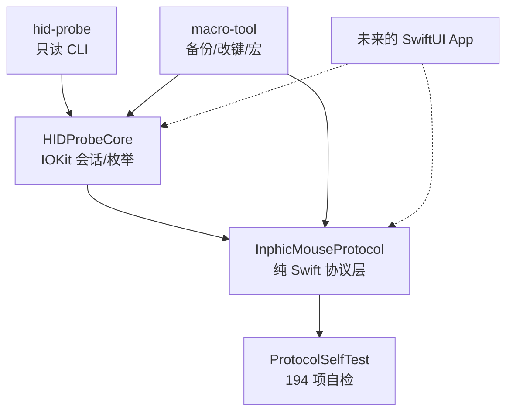

# 架构

## 1. 目标与非目标

**目标**

- 在 macOS 上直接与 IN9 升级版的厂商 HID 接口通信。
- 协议层可独立测试，不依赖 UI 或真实硬件。
- 所有写操作可备份、可恢复、可审计。
- 为后续 SwiftUI App 提供稳定的 Service 边界。

**非目标（当前阶段）**

- 固件升级、出厂复位。
- 蓝牙模式配置。
- 在协议证据不足时猜测命令。
- 一次性交付完整 UI。

## 2. 模块



| 模块 | 职责 |
|------|------|
| `Sources/InphicMouseProtocol` | 帧组装/解析、校验和、设备信息、DPI、灯光、按键映射、宏编码 |
| `tools/hid-probe/Sources/HIDProbeCore` | `IOHIDManager` 枚举、接口号解析、打开/关闭、同步交换、只读命令白名单 |
| `tools/hid-probe/Sources/hid-probe` | 命令行：`list` / `probe` / `monitor` |
| `tools/macro-tool` | 命令行：`backup` / `plan` / `apply` / `set-key` / `restore` |
| `Sources/ProtocolSelfTest` | 无 XCTest 环境下的协议回归测试 |
| `docs/` | 协议证据、移植计划、验证状态、使用手册 |

## 3. 数据流

```text
CLI 参数
  → HIDEnumerator.entries()
      → IOHIDManager 匹配 VID 248A/249A
      → 读 IORegistry 的 bInterfaceNumber
  → selectTarget(): 厂商 VID + interface 2
  → HIDDeviceSession.open(kIOHIDOptionsTypeNone)
  → exchange(frame, mode: .strip)
      → IOHIDDeviceSetReport(32 字节，reportID=0)
      → 输入报告回调 + runloop 泵
      → 返回 wrote / acked / responses / ackOffset
  → Codec 解析 / 新帧编码
  → 备份 → 写 → 读回 → 报告四态
```

### 3.1 设备选择

- 不硬编码 PID：已发现 `0x5C2F`，上游记录 `0x8266`；按厂商 `0x248A/0x249A` + `bInterfaceNumber == 2` 选择。
- `IOHIDManagerSetDeviceMatching(nil)` 会打开全部 HID；只要有一个 collection 返回 `kIOReturnUnsupported`，整体打开失败。`HIDEnumerator` 会退回 `IOHIDManagerSetDeviceMatchingMultiple`，只匹配两个 Inphic 厂商 ID。
- 不使用 `kIOHIDOptionsTypeSeizeDevice`，避免抢占鼠标/键盘。

### 3.2 报告 ID

Windows 侧逻辑帧 33 字节，首字节为 report ID `0`。macOS 上：

- 必须把首字节去掉，`IOHIDDeviceSetReport(..., reportID: 0, bytes[1...32])`，即 **strip 32 字节**。
- 原样发送 33 字节（`keep`）会返回 `kIOReturnSuccess` 但设备无响应。
- 输入响应可能是 32 字节；ACK 偏移由 `ackOffset` 表示，解析时不要写死。

### 3.3 帧格式

```text
offset  0      1       2  3  4          5 ........ 31        32
        reportID command 00 01 length   payload (checksummed) checksum
```

- 长度字段是 payload 字节数。
- 校验和 = `sum(payload) & 0xFF`，**不包含头部**。
- payload 不足 27 字节时补 0，这些 0 也参与校验。

### 3.4 按键映射

`0x09` payload 为每键 3 字节 `[type, v1, v2]`，6 键共 18 字节：

- `0x10` 鼠标按钮（v1 = 按钮位）
- `0x20` 滚轮/特殊功能
- `0x40` DPI（v1 = 1 循环 / 2 + / 3 −）
- `0x70` 键盘键（v1 = 修饰掩码，v2 = HID Usage）
- `0x90` 宏（v1 低半字节 = 槽 + 1，高半字节 = 重复标志）
- `0x60` 系统/关闭，`0x80` 多媒体，`0x30` 连发

设备 `0x11` 返回 6 项：5 个 HID 按钮 + DPI。滚轮上/下是轴，不是按键。

### 3.5 宏

`0x08` 把宏事件流写入槽位：

- `buf[4] = 事件数 * 4 + 1`，`buf[5] = 槽 + 1`
- 事件 4 字节：`30` 按下 / `B0` 松开 / `10` 延时（小端 ms）
- 超过 6 事件按 27 字节分块，块头包含块序与总块数
- 宏槽 = 被绑定键的下标（官方约定）

宏**只能写不能读**（`0x18` 无响应），因此 `macro-tool apply` 在写入前要求 `--yes`，并明确提示旧宏不可恢复。

## 4. 备份与恢复

`backup` 读取 `0x10`–`0x17`、`0x20`，保存为 JSON：

```json
{
  "savedAt": "...",
  "vendorID": 9370,
  "productID": 23599,
  "interfaceNumber": 2,
  "records": [
    { "command": "0x11", "responsesHex": ["11 00 01 12 ..."], "ack": true, "ackOffset": 0 }
  ]
}
```

`restore` 从备份中取 `0x11` 载荷，重新编码 `0x09` 发送。它只恢复按键映射，不恢复宏。

## 5. 安全不变量

1. 写命令必须显式 `--yes`；默认 dry-run。
2. 写前自动备份；备份失败则不写。
3. `0x08` 每帧都要求 `wrote && acked`，否则不写 `0x09`。
4. 写后读回 `0x11` 并逐字节比对。
5. 输出分四态：发送 / ACK / 读回 / 执行，禁止把前三者写成“成功执行”。
6. 只读探针使用命令白名单，拒绝写入、复位与未知命令。

## 6. 测试策略

- **纯协议**：`swift run protocol-selftest`，194 项。覆盖帧长度、字节序、校验和、空/最大 payload、宏分块、按键编码、DPI 换算。
- **探针**：`swift run probe-selftest`，76 项。覆盖只读命令帧与 ACK 解析。
- **真机**：`docs/STATUS.md` 记录环境、原始帧、ACK、读回与实际执行结果；未做过的项目明确写“未验证”。
- CI 只跑前两层，不接触硬件。

## 7. 设计决策

| 决策 | 原因 | 代价 |
|------|------|------|
| IOKit 而非 libusb/hidapi | 系统自带、无需驱动、可访问复合设备接口 | API 偏 C，回调/runloop 需要封装 |
| 按 interface 2 选择 | 厂商配置接口在复合设备中稳定 | 需读 IORegistry，不能只看 VID/PID |
| PID 不硬编码 | 接收器批次/模式会导致 PID 不同 | 可能误选同厂商其它设备，需要 `--index` 兜底 |
| strip 32 字节 | 实测 keep 无响应 | 与 Windows 代码不能直接共用发送函数 |
| 先 CLI 后 UI | 协议未稳定时 UI 会掩盖硬件问题 | 早期用户需要命令行 |
| 自检可执行文件而非 XCTest | CLT 环境没有 XCTest | 需要自己维护断言/计数 |
| 备份 + `--yes` | 硬件写不可逆，尤其宏 | 操作步骤更多 |

## 8. 后续

- **Phase 4 SwiftUI App**：`DeviceService` 包装 `HIDProbeCore`，`MacroStore` 管理本地宏，视图分设备/宏/按键/设置/诊断。
- **DPI/灯光写入**：已有 Codec，需要补写命令、读回与恢复流程。
- **宏编辑器**：事件表、录制、循环设置、上传状态。
- **打包**：`.app` / `.dmg`、arm64、未签名说明；公证需要 Apple Developer 账号。
- **更多设备**：记录 VID/PID/接口/描述符，先只读探测，再逐条验证写命令。
